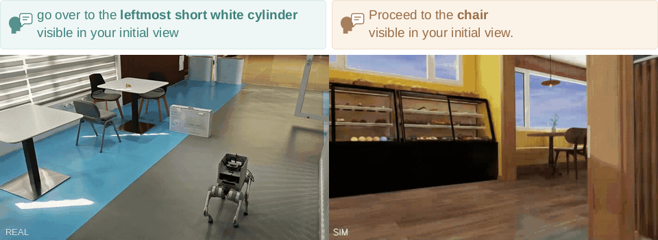

<h1 align="center">ScaleNav</h1>

<h3 align="center">Scalable Internet Video Pretraining<br>for Language-Conditioned Local Navigation</h3>

<p align="center">
  <a href="https://zju3dv.github.io/ScaleNav/"></a>
  
  <a href="https://huggingface.co/Yangyihui/ScaleNav"></a>
  <a href="https://huggingface.co/datasets/Yangyihui/ScaleNav-Data"></a>
</p>

<p align="center">
  <a href="https://yangyihui0502.github.io/">Yihui Yang</a><sup>1</sup> ·
  <a href="https://yuanhongyu.xyz/">Yuanhong Yu</a><sup>1</sup> ·
  <a href="https://pluswave.top/">Jiawei Wang</a><sup>1</sup> ·
  Zhongrui Yu<sup>2</sup> ·
  Jia Shi<sup>2</sup><br>
  <a href="https://zhankunliauto.github.io/">Kun Zhan</a><sup>2</sup> ·
  <a href="https://csse.szu.edu.cn/staff/ruizhenhu/">Ruizhen Hu</a><sup>3</sup> ·
  <a href="https://xzhou.me/">Xiaowei Zhou</a><sup>1</sup> ·
  Yu&nbsp;Liu<sup>2</sup> ·
  <a href="https://pengsida.net/">Sida Peng</a><sup>1</sup>
</p>

<p align="center">
  <sup>1</sup>&nbsp;Zhejiang University &nbsp; <sup>2</sup>&nbsp;Li Auto Inc. &nbsp; <sup>3</sup>&nbsp;Shenzhen University
</p>

> **TL;DR:** ScaleNav learns navigation priors from Internet videos through **action-free pretraining**, then transfers them to **language-conditioned local navigation**.

<p align="center">
  <a href="https://zju3dv.github.io/ScaleNav/#demos"></a>
</p>

<p align="center">
  <a href="#installation">Installation</a> ·
  <a href="#checkpoints">Checkpoints</a> ·
  <a href="#data">Data</a> ·
  <a href="#quick-test">Quick test</a> ·
  <a href="#evaluation">Evaluation</a> ·
  <a href="#training">Training</a> ·
  <a href="#real-robot">Real robot</a>
</p>

## Installation

<a id="hardware"></a>
<a id="environment"></a>
<a id="simulator-installation"></a>
<a id="build-dependencies"></a>
<a id="build-habitat-gs"></a>
<a id="scene-converter"></a>
<a id="optional-dependencies"></a>
<a id="development"></a>

Use Linux and an NVIDIA GPU with BF16 support. We recommend **24 GB GPU memory**
and **64 GB system RAM** for inference and evaluation.

Follow the [installation guide](docs/INSTALL.md) to set up the `scalenav`
environment, Habitat-GS and the scene converter.

## Checkpoints

| Model | Download | Size |
| --- | --- | ---: |
| ScaleNav | [Hugging Face](https://huggingface.co/Yangyihui/ScaleNav) | 10.02 GB |
| Wan VAE, text encoder and tokenizer | [Wan2.2-TI2V-5B](https://huggingface.co/Wan-AI/Wan2.2-TI2V-5B) | 14.20 GB |

Follow the [checkpoint download steps](docs/INSTALL.md#checkpoints) to download
both models and set `CHECKPOINT` and `BASE_MODEL`.

## Data

Select a dataset below for its complete download and preparation instructions,
including our annotations and the required upstream assets.

| Dataset | Purpose | Contents | Network download | Disk usage after preparation |
| --- | --- | --- | ---: | ---: |
| [Habitat-GS-LN test subset](docs/EVALUATION.md#test-subset) | Preview navigation and visualizations | 16 tasks / 13 scenes | 991.32 MB | 2.96 GB |
| [Full Habitat-GS-LN evaluation](docs/EVALUATION.md#full-habitat-gs-ln) | Report Habitat-GS-LN SR/SPL | 157 tasks / 45 scenes | 3.17 GB | 10.36 GB |
| [Short-Horizon OVON test subset](docs/EVALUATION.md#ovon-test-subset) | Preview navigation on HM3D | 7 tasks / 7 scenes | 642.85 MB | 642.90 MB |
| [Full Short-Horizon OVON evaluation](docs/EVALUATION.md#full-short-horizon-ovon) | Report Short-Horizon OVON SR/SPL | 524 tasks / 36 scenes | 5.84 GB | 3.67 GB |
| [Small training subset (for preview)](docs/DATA.md#small-training-subset) | Check the training pipeline | 17 Internet segments / 4 simulated episodes | 55.60 MB | 239.54 MB |
| [Full training data](docs/DATA.md#full-training-data) | Pretrain and fine-tune ScaleNav | 18,249 Internet segments / 2,600 simulated episodes, including validation | 36.10 GB | 153.04 GB |

Network download includes all sources. Disk usage includes prepared assets and
retained downloads after cleanup; full OVON needs **9.34 GB** before archive cleanup.
Model weights, environments, training caches and run outputs are separate.
See [data details](docs/DATA.md#choose-a-download) or
[ScaleNav Data](https://huggingface.co/datasets/Yangyihui/ScaleNav-Data#choose-a-dataset).

<a id="quick-start"></a>

## Quick test

After [installation](#installation) and [checkpoint downloads](#checkpoints),
run the **Habitat-GS-LN test subset** to view navigation videos and trajectories.
It contains **16 tasks in 13 scenes**, requiring **991.32 MB** of network
downloads and **2.96 GB** on disk after preparation.

### Prepare the test subset

Request [InteriorGS access](https://huggingface.co/datasets/spatialverse/InteriorGS)
and accept its [terms](https://kloudsim-usa-cos.kujiale.com/InteriorGS/InteriorGS_Terms_of_Use.pdf),
then prepare the data:

```bash
hf auth login
export PATH="$PWD/external/splat-tools/node_modules/.bin:$PATH"
python scripts/prepare_data.py evaluation --subset test_subset \
  --source data/upstream/evaluation --output data/evaluation/test_subset --download
```

### Run navigation

Run the prepared test subset with visualization enabled:

```bash
export EVAL_SET=test_subset
python -m awm.scripts.eval_habitat_gs \
  --eval_config src/awm/configs/eval_habitatgs.yaml \
  --episode_manifest data/evaluation/"$EVAL_SET"/episodes.json \
  --gs_dataset_root data/upstream/evaluation \
  --scene_dataset_config data/evaluation/"$EVAL_SET"/scenes.scene_dataset_config.json \
  --model_path "$CHECKPOINT" --pretrained_model_path "$BASE_MODEL" \
  --visualize --output_dir outputs/evaluation/"$EVAL_SET"
```

Open `outputs/evaluation/test_subset/gallery/index.html` to view the videos and
trajectories. Metrics are saved in `outputs/evaluation/test_subset/summary.json`.

To try the other benchmark, follow the
[Short-Horizon OVON test subset](docs/EVALUATION.md#ovon-test-subset).
Test subsets contain selected successful cases; use [full evaluation](#evaluation)
for benchmark scores.

<a id="single-image-inference"></a>

For a standalone trajectory prediction from one image, see
[single-image inference](docs/INFERENCE.md#single-image-inference).

## Evaluation

Evaluate the released policy on the **full Habitat-GS-LN (157 tasks)** and
**full Short-Horizon OVON (524 tasks)** benchmarks. Complete
[installation](docs/INSTALL.md) and set the model paths using
[checkpoint setup](docs/INSTALL.md#checkpoints).

### Habitat-GS-LN

Obtain [InteriorGS access](docs/EVALUATION.md#full-habitat-gs-ln), then prepare
all 45 scenes and run the full benchmark:

```bash
hf auth login
export PATH="$PWD/external/splat-tools/node_modules/.bin:$PATH"
python scripts/prepare_data.py evaluation --subset full \
  --source data/upstream/evaluation \
  --output data/evaluation/habitatgs_ln --download

export EVAL_SET=habitatgs_ln
python -m awm.scripts.eval_habitat_gs \
  --eval_config src/awm/configs/eval_habitatgs.yaml \
  --episode_manifest data/evaluation/"$EVAL_SET"/episodes.json \
  --gs_dataset_root data/upstream/evaluation \
  --scene_dataset_config data/evaluation/"$EVAL_SET"/scenes.scene_dataset_config.json \
  --model_path "$CHECKPOINT" --pretrained_model_path "$BASE_MODEL" \
  --visualize --output_dir outputs/evaluation/"$EVAL_SET"
```

### Short-Horizon OVON

Download the two HM3D validation archives using the
[full OVON data guide](docs/EVALUATION.md#full-short-horizon-ovon).
Set `HM3D_ARCHIVES` to their directory, then prepare all 36 scenes and run:

```bash
export HM3D_ARCHIVES=/path/to/hm3d-archives
python scripts/prepare_data.py ovon --subset full \
  --hm3d-archives "$HM3D_ARCHIVES" \
  --source data/upstream/evaluation/ovon \
  --scenes data/upstream/evaluation/hm3d \
  --output data/evaluation/short_horizon_ovon --download

export EVAL_SET=short_horizon_ovon
python -m awm.scripts.eval_habitat_gs \
  --eval_config src/awm/configs/eval_ovon.yaml \
  --episode_manifest data/evaluation/"$EVAL_SET"/episodes.json \
  --gs_dataset_root data/evaluation/"$EVAL_SET" \
  --scene_dataset_config data/evaluation/"$EVAL_SET"/scenes.scene_dataset_config.json \
  --model_path "$CHECKPOINT" --pretrained_model_path "$BASE_MODEL" \
  --visualize --output_dir outputs/evaluation/"$EVAL_SET"
```

### Results

For each benchmark, results are saved under `outputs/evaluation/$EVAL_SET/`:

- `summary.json`: `aggregate.success_rate` (SR), `aggregate.spl` (SPL) and per-task results.
- `gallery/index.html`: navigation videos, trajectories, targets and outcomes.

Omit `--visualize` for metrics only. See the
[evaluation protocol](docs/EVALUATION.md#evaluation-protocol) for success and STOP definitions.

## Training

ScaleNav first learns from instruction-conditioned Internet videos, then learns
navigation actions from simulated trajectories with Internet-video replay.
Run the four phases in order:

| Phase | Purpose | Training input |
| --- | --- | --- |
| P0: video adaptation | Adapt the native Wan video model | Internet videos |
| P1: causal pretraining | Learn to predict with observation history | Internet videos |
| Action alignment | Learn navigation actions | Simulated trajectories + Internet-video replay |
| Joint fine-tuning | Jointly refine video and action prediction | Simulated trajectories + Internet-video replay |

### Prepare training inputs

1. Prepare the [full training data](docs/DATA.md#full-training-data). This writes
   instruction-labeled videos to `$TRAIN_DATA/internet/` and action-labeled
   trajectories to `$TRAIN_DATA/simulation/`. Use the
   [small subset](docs/DATA.md#small-training-subset) to preview the pipeline.
2. [Build the training caches](docs/DATA.md#build-training-caches) for the training
   splits. The trainer reads `video-cache/train/`, `action-cache/`, simulation
   metadata and `simulation/train.txt` under the same `TRAIN_DATA` directory.
3. Download the [complete native Wan model](docs/TRAINING.md#native-wan-weights)
   (**34.20 GB**, including transformer weights) for P0 initialization.

Choose GPU and offload settings using the
[training memory requirements](docs/TRAINING.md#installation-and-memory).
The example below uses **8 GPUs** with a micro-batch of **1** per GPU.
For optimizer offload, install [DeepSpeed](docs/INSTALL.md#deepspeed) and add
`--deepspeed` to each training command.

### Run the four phases

Set the prepared data paths and output directory:

```bash
export BASE_MODEL=checkpoints/Wan2.2-TI2V-5B
export TRAIN_DATA="${TRAIN_DATA:-data/training/goto}"
export VIDEO_CACHE="$TRAIN_DATA/video-cache/train"
export ACTION_CACHE="$TRAIN_DATA/action-cache"
export ACTION_META="$TRAIN_DATA/simulation/awm_meta.jsonl"
export ACTION_SPLIT="$TRAIN_DATA/simulation/train.txt"
export RUN=outputs/scalenav
```

Check the video cache before starting optimization:

```bash
awm train --stage p0 --base-model "$BASE_MODEL" --video-cache "$VIDEO_CACHE" \
  --output "$RUN/p0" --check-data
```

Run each command after the preceding phase finishes. `--initialize-from` passes
the previous phase's checkpoint to the next:

```bash
torchrun --standalone --nproc_per_node=8 --module awm.training.runner \
  --stage p0 --base-model "$BASE_MODEL" --video-cache "$VIDEO_CACHE" \
  --output "$RUN/p0" --micro-batch 1 --save-every 2000

torchrun --standalone --nproc_per_node=8 --module awm.training.runner \
  --stage p1 --base-model "$BASE_MODEL" --video-cache "$VIDEO_CACHE" \
  --initialize-from "$RUN/p0/checkpoint-2000" \
  --output "$RUN/p1" --micro-batch 1 --save-every 8000

torchrun --standalone --nproc_per_node=8 --module awm.training.runner \
  --stage align --base-model "$BASE_MODEL" --video-cache "$VIDEO_CACHE" \
  --action-cache "$ACTION_CACHE" --action-meta "$ACTION_META" --action-split "$ACTION_SPLIT" \
  --initialize-from "$RUN/p1/checkpoint-10000" \
  --output "$RUN/align" --micro-batch 1 --save-every 2500

torchrun --standalone --nproc_per_node=8 --module awm.training.runner \
  --stage joint --base-model "$BASE_MODEL" --video-cache "$VIDEO_CACHE" \
  --action-cache "$ACTION_CACHE" --action-meta "$ACTION_META" --action-split "$ACTION_SPLIT" \
  --initialize-from "$RUN/align/checkpoint-2500" \
  --output "$RUN/joint" --micro-batch 1 --save-every 6500
```

Phase outputs are saved under `$RUN/p0/`, `$RUN/p1/`, `$RUN/align/` and
`$RUN/joint/`. The final navigation policy is in `$RUN/joint/`; checkpoints
include model weights and resumable training state.
See the [training guide](docs/TRAINING.md) for schedules and losses, and
[checkpoint resume](docs/TRAINING.md#resume-and-use-trained-weights) to continue an interrupted run.

## Real robot

Start the policy server on the GPU machine:

```bash
awm serve --checkpoint "$CHECKPOINT" --base-model "$BASE_MODEL" --decode-video
```

Open `http://127.0.0.1:8620/` for live camera, prediction and trajectory views.
Follow the [Go2 setup](docs/INFERENCE.md#robot-adapter) to connect the camera and
controller, or use the [HTTP API](docs/INFERENCE.md#http-api) with another platform.

## License

Code: [Apache-2.0](LICENSE). Model weights:
[CC BY-NC 4.0](https://huggingface.co/Yangyihui/ScaleNav/blob/main/LICENSE).
Annotations and released Internet videos:
[CC BY-NC-SA 4.0](annotations/LICENSE).
See [third-party notices](THIRD_PARTY_NOTICES.md) for attribution and license scope.
